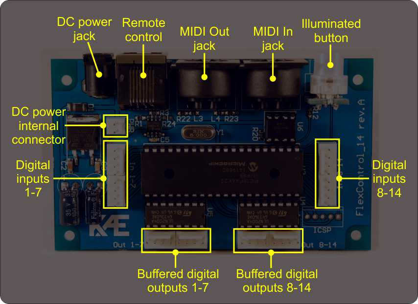
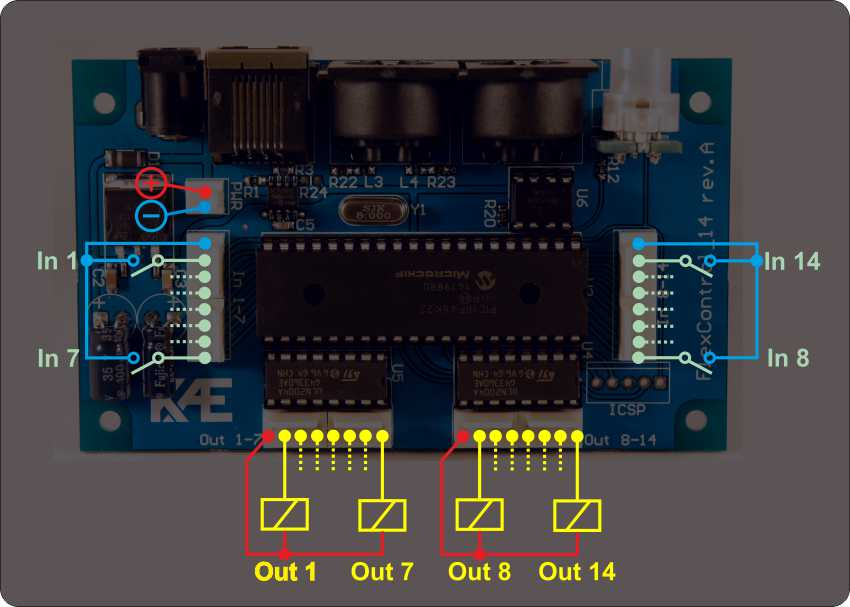
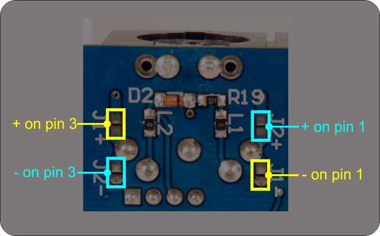
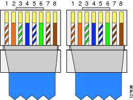
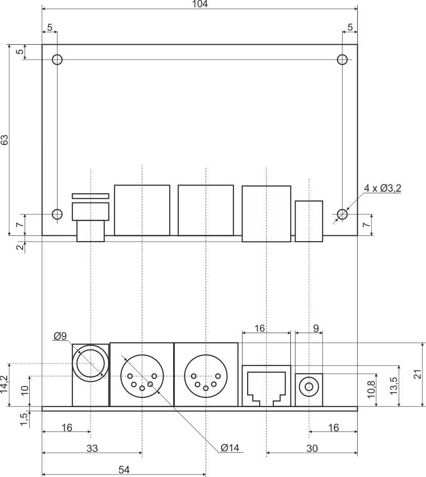

# FlexControl 14

## What is it?

`FlexControl 14` is a multi-purpose MIDI controller and decoder. It drives 14 buffered digital outputs, which can be controlled at the same time by its 14 on-board digital inputs, by incoming MIDI messages, or by a second `FlexControl 14` board. Any digital input can also transmit up to three MIDI messages at once.

### Hardware features

- 14 high-current open-collector digital outputs for relays / LEDs
- 14 digital inputs (pulled up) for buttons or switches
- All digital inputs and outputs are brought out on standard 2.54 mm male headers
- 1 ‘MIDI In’ DIN5 connector
- 1 ‘MIDI Out’ DIN5 connector
- Semi-transparent illuminated button for programming MIDI presets
- RJ-45 jack for connecting a second `FlexControl 14` board as a remote control, over a straight-through Ethernet cable
- Phantom power with selectable polarity on pins 1 and 3 of the ‘MIDI In’ jack
- 2.5 mm DC power jack (center pin negative)
- 2-pin DC power connector
- Reverse polarity protection
- Specially designed for panel mounting
- Non-volatile memory holding the configuration and the presets

## Intended audience

Anyone with a basic knowledge of low-voltage electrical circuits and of the MIDI protocol.

## Wiring diagram

## Digital inputs

All 14 digital input pins are suitable for buttons and footswitches. Momentary (non-retentive) and latching (retentive) types both work. Wire each button between its input pin and GND / 0 V, as shown in the wiring diagram above.

An unwired input pin is pulled up to +5 V.

## Digital outputs

All 14 digital output pins are suitable for resistive or inductive loads — relays, fans, LEDs and the like.

## Operation

- A digital input acts only on the output with the same number (In 1 → Out 1, In 2 → Out 2, and so on).
- All 14 digital outputs latch, unless they are configured otherwise.
- Any output can instead be configured as a pulse output. Pulse outputs fire together whenever another digital output changes state.
- Every output except a pulse output can be switched individually by a MIDI ‘Control Change’ message: a value below 64 turns it off, a value of 64 or above turns it on. An output in a mutex group reacts only to values of 64 or above.
- Some or all outputs can be placed in a mutex group. The board can also memorize the state of the non-mutex outputs and restore it when the same mutex output becomes active again.
- A MIDI ‘Program Change’ message switches every latching output at once. Pulse outputs are not set by it, but they still fire alongside the others.
- A MIDI preset can also be programmed on the board itself, without the web configurator (see [Offline MIDI preset programming](#offline-midi-preset-programming)).

### What can be configured?

- Function per digital input pin: Digital or MIDI Rx inhibit
- Function per digital output pin: Latch or Pulse
- Reactions to the falling and rising edges of the digital inputs:
  - turn a digital output on or off, or toggle it
  - send up to three MIDI messages at once — every short message type is supported, each on its own channel
- Output polarity (normally off or normally on)
- Mutually exclusive outputs (a “mutex” group). Only one output in the group can be active at a time, and mutex and non-mutex outputs can work side by side.
- Delay at start-up
- MIDI reception channel: all channels, or a single selected one
- MIDI Rx controller (CC) number per digital output
- MIDI presets, recalled by incoming ‘Program Change’ messages

## Second board

If you link two boards with a straight-through Ethernet cable, the primary one keeps working as the **Host** and the second becomes the **Remote**. The Remote’s digital inputs work in parallel with the Host’s and its outputs copy the Host’s, so it serves as a second control panel wherever the Host itself is out of reach.

**Important:** Power the Remote board only from the Host board, through the Ethernet cable. Do not connect a power supply to the Remote board — neither to the DC power jack nor to the internal DC power connector.  
**Important:** Do not connect a MIDI interface to the DIN5 jacks of the Remote board, even if they are fitted.

### Operation

- Input and output pin functions mirror those of the Host.
- The Remote’s outputs copy the state of the Host’s outputs.
- It can make the Host transmit its configured MIDI messages.
- It does not react to MIDI ‘Program Change’ or ‘Control Change’ messages.
- It does not transmit MIDI messages of its own.

### What can be configured?

- Reactions in the Host to the falling and rising edges of the Remote’s digital inputs: turn a digital output in the Host on or off, or toggle it

## Configuration

### Detailed configuration

Detailed configuration is possible only with the [**FlexControl Web Configurator**](https://kaladim.github.io/flexcontrol-web-configurator-public/) application. Its [user’s guide](https://github.com/kaladim/flexcontrol-web-configurator-public) explains how to use it.

### Offline MIDI preset programming

This applies to the Host board only. It assumes the board has already been configured with the [**FlexControl Web Configurator**](https://kaladim.github.io/flexcontrol-web-configurator-public/), especially if MIDI ‘Control Change’ messages are needed.

1. Power the `FlexControl 14` board on.
2. Connect the ‘MIDI Out’ jack of your MIDI controller to the ‘MIDI In’ jack of the `FlexControl 14` board.
3. Press and hold the illuminated button until it starts blinking with a short pulse.
4. Set the outputs to the states you want to store, using the on-board inputs, the Remote, or MIDI ‘Control Change’ messages.
5. Send a MIDI ‘Program Change’ message from your controller. The button starts blinking rapidly.
6. Press the button briefly to store the preset. It lights up for a moment, then returns to the short-pulse blink.
7. Repeat steps 4 to 6 for any further presets.
8. To leave the programming sequence, press and hold the button until it goes out, or leave the board idle for about two minutes.

## Supplying phantom power to the MIDI In jack

Some MIDI devices draw their power from the spare pins **1** and **3** of the ‘MIDI Out’ jack that feeds them. `FlexControl 14` supports this: its power inputs — the DC power jack and the internal DC power connector — are brought to four jumper pads on the underside of the board. Depending on the device you want to power, bridge either **J1+** and **J1-**, or **J2+** and **J2-**, as shown below:

**Important:** Never bridge a J1 and a J2 jumper at the same time. That short-circuits the power supply and will almost certainly destroy it — and the `FlexControl 14` with it.

## Electrical specifications

- Supply voltage: 7.5 – 25 V, 9 – 15 V recommended
- Maximum total current through all outputs: 3 A
- Maximum current per output: 500 mA
- Quiescent current: 26 mA at 9 V (no load, all outputs off, LED off)

## MIDI implementation chart

| Message type | Code | Can receive | Can send |
| --- | --- | --- | --- |
| Note Off | 8x | - | Yes |
| Note On | 9x | - | Yes |
| Poly Aftertouch | Ax | - | Yes |
| Control Change | Bx | Yes | Yes |
| Program Change | Cx | Yes | Yes |
| Channel Pressure | Dx | - | Yes |
| Pitch Bend | Ex | - | Yes |
| Quarter Frame (MTC) | F1 | - | Yes |
| Song Pointer | F2 | - | Yes |
| Song Select | F3 | - | Yes |
| Tune Request | F6 | - | Yes |
| Timing Clock | F8 | - | Yes |
| Start | FA | - | Yes |
| Continue | FB | - | Yes |
| Stop | FC | - | Yes |
| Active Sensing | FE | - | Yes |
| Reset | FF | - | Yes |

*x in the code stands for the MIDI channel (0–F).*

## Straight-through Ethernet cable pinout

## Mechanical parameters

All dimensions in millimeters.
